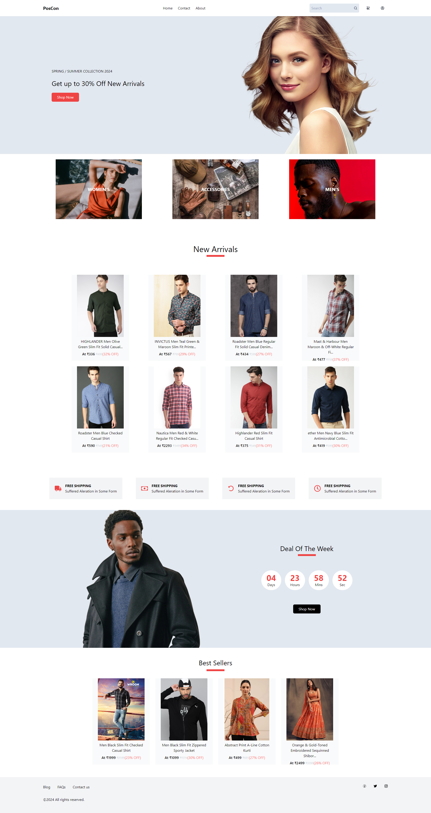
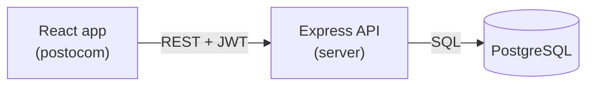

# Poscon

Poscon is a full-stack e-commerce store for clothing and accessories. Shoppers can browse products by category, view product details, sign up and log in, add items to a cart and check out.

**Live demo:** _coming soon_

**Demo account:** `demo@poscon.dev` / `demo1234` (created by the seed script)



## Features

- Product catalogue for men, women and accessories, with new arrivals and bestsellers on the home page
- Product search from the navbar, with filters for gender, category and price range
- Sorting by newest, popularity (units sold), price and biggest discount, with pagination
- Search, filters, sort and page are kept in the URL, so results can be shared, reloaded and navigated with the back button
- Product pages with their own shareable URL (`/product/:id`), discount pricing and quantity selection
- Account signup, login and logout with hashed passwords (bcrypt) and JWT authentication
- Shared login state across the app, protected cart and profile pages, and automatic logout when a session expires
- Cart with quantity controls, item removal, live subtotal and a navbar item count badge
- Adding a product that is already in the cart increases its quantity instead of duplicating it
- Checkout with a shipping address form, prefilled from the user's profile
- Orders are created in a single database transaction that locks the cart, so a double click cannot place the same order twice
- Order history and order detail pages, with the price paid saved on each order item
- Simulated payment step with card, UPI and cash on delivery, including declined payments and retries (see [Demo Payments](#demo-payments))
- Profile page for the logged-in user
- Custom 404 page for unknown URLs
- Database migrations and seed data, so the whole app can be set up with one command

### Security

- The user is always identified from the JWT, never from the request body
- Tokens are sent in the `Authorization: Bearer` header and expire after 7 days
- Every request body is validated with zod
- Login and signup are rate limited
- Security headers with helmet, and CORS restricted to the frontend URL
- Password hashes are never returned by the API
- Only the card brand and last four digits are stored for payments, never the full card number or CVV

## Tech Stack

| Layer    | Technology                                           |
| :------- | :--------------------------------------------------- |
| Frontend | React 18, React Router, Tailwind CSS, MUI, Axios      |
| Backend  | Node.js, Express, JSON Web Tokens, bcrypt, zod        |
| Database | PostgreSQL                                            |

## Architecture



```
poscon/
├── postocom/              # React frontend
│   └── src/
│       ├── api/client.js  # Shared axios client (base URL, auth header, session expiry)
│       ├── context/       # Auth and cart state shared across the app
│       └── component/     # Pages and UI components
├── server/                # Express API
│   ├── server.js          # Entry point
│   ├── src/
│   │   ├── app.js         # Express setup, middleware and routes
│   │   ├── config/        # Environment and database pool
│   │   ├── routes/        # Route definitions
│   │   ├── controllers/   # Request handlers
│   │   ├── middleware/    # Auth, validation, rate limiting, errors
│   │   ├── validation/    # zod request schemas
│   │   └── utils/
│   └── db/
│       ├── migrations/    # SQL schema, applied in order
│       ├── migrate.js     # Migration runner
│       ├── seed.js        # Sample products and demo user
│       └── products.js    # Seed product data
└── demo/                  # Screenshots
```

### Database

| Table        | Purpose                                                        |
| :----------- | :------------------------------------------------------------- |
| `users`      | Accounts with email, phone number and bcrypt password hash     |
| `products`   | Catalogue with price, sale price, gender, category, bestseller flag |
| `cart`       | Items in a user's cart, one row per product                     |
| `orders`     | Placed orders with status, total and shipping address           |
| `order_items`| Products in each order, with the name, image and price at purchase time |
| `payments`   | Every payment attempt with its result, amount and transaction ID |
| `bestseller` | View over `products` where the bestseller flag is set          |

## Getting Started

### Prerequisites

- Node.js 18 or newer
- PostgreSQL 14 or newer, running locally

### 1. Clone the repository

```bash
git clone https://github.com/thakaresahil/poscon.git
cd poscon
```

### 2. Set up the API

```bash
cd server
npm install
cp .env.example .env
```

Edit `.env` with your PostgreSQL details and a long random `SESSION_SECRET`, then create the database and load the sample data:

```bash
createdb poscon
npm run db:reset
npm run dev
```

The API runs on `http://localhost:9000`.

### 3. Set up the frontend

In a new terminal:

```bash
cd postocom
npm install
cp .env.example .env
npm start
```

The app opens at `http://localhost:3000`.

### Environment variables

**server/.env**

| Variable         | Description                                         |
| :--------------- | :-------------------------------------------------- |
| `PG_USER`        | PostgreSQL user                                     |
| `PG_HOST`        | PostgreSQL host                                     |
| `PG_DATABASE`    | Database name                                       |
| `PG_PASSWORD`    | PostgreSQL password                                 |
| `PG_PORT`        | PostgreSQL port                                     |
| `PORT`           | Port the API listens on (default `9000`)            |
| `CLIENT_ORIGIN`  | Frontend URL(s) allowed by CORS, comma separated    |
| `SESSION_SECRET` | Secret used to sign JWTs                            |

**postocom/.env**

| Variable            | Description                                   |
| :------------------ | :-------------------------------------------- |
| `REACT_APP_API_URL` | URL of the API (default `http://localhost:9000`) |

### Scripts

Run these inside `server/`:

| Command              | Description                                   |
| :------------------- | :-------------------------------------------- |
| `npm start`          | Start the API                                 |
| `npm run dev`        | Start the API and restart on file changes     |
| `npm run db:migrate` | Apply any new migrations                      |
| `npm run db:seed`    | Replace all data with the sample data         |
| `npm run db:reset`   | Drop everything, migrate and seed             |

## API Reference

Endpoints marked 🔒 need an `Authorization: Bearer <token>` header, which the frontend sends automatically after login.

| Method  | Endpoint                      | Description                              |
| :------ | :---------------------------- | :--------------------------------------- |
| `POST`  | `/signup/user`                | Create an account (`email`, `pnum`, `password`) |
| `POST`  | `/login`                      | Log in and receive a token (`email`, `password`) |
| `GET`   | `/data`                       | Latest products for the home page        |
| `GET`   | `/home/bestseller`            | Bestselling products                     |
| `GET`   | `/products`                   | Search and filter products (see below)   |
| `GET`   | `/products/categories`        | Product categories with product counts   |
| `GET`   | `/products/:id`               | A single product                         |
| `GET`   | `/profile` 🔒                 | Logged-in user's profile                 |
| `GET`   | `/cartdata` 🔒                | Items in the user's cart                 |
| `POST`  | `/addtocart` 🔒               | Add a product to the cart, or increase its quantity (`pid`, `count`) |
| `PATCH` | `/cart/:id` 🔒                | Change the quantity of a cart item (`quantity`, 1 to 10) |
| `DELETE`| `/cart/:id` 🔒                | Remove an item from the cart             |
| `POST`  | `/orders` 🔒                  | Place an order from the cart (`name`, `phone`, `address`, `city`, `pincode`) |
| `GET`   | `/orders` 🔒                  | The user's orders, newest first           |
| `GET`   | `/orders/:id` 🔒              | A single order with its items, shipping address and payment details |
| `POST`  | `/orders/:id/pay` 🔒          | Pay for an order with `card`, `upi` or `cod` (simulated) |

### Product search

`GET /products` accepts these query parameters, all optional:

| Parameter  | Description                                                          |
| :--------- | :------------------------------------------------------------------- |
| `q`        | Text to search for in the product name, description and category     |
| `gender`   | `men` or `women`                                                      |
| `category` | A category from `/products/categories`, e.g. `accessories`           |
| `minPrice` | Lowest sale price in rupees                                          |
| `maxPrice` | Highest sale price in rupees                                         |
| `sort`     | `newest` (default), `popular`, `price_asc`, `price_desc` or `discount` |
| `page`     | Page number, starting at 1                                           |
| `limit`    | Products per page, 1 to 48 (default 12)                              |

Example: `/products?q=shirt&gender=men&sort=price_asc&page=1`

The response contains `products`, `total`, `page`, `limit` and `totalPages`. Text search uses a trigram index (`pg_trgm`) so it stays fast as the catalogue grows.

Errors are returned as JSON in the form `{ "error": "message" }` with a matching status code (`400`, `401`, `402`, `404`, `409`, `429` or `500`).

## Demo Payments

Payments are simulated. No real payment gateway is used and no money is taken. Card numbers are checked with the Luhn algorithm and the expiry date must be in the future.

| Method | Test value            | Result             |
| :----- | :-------------------- | :----------------- |
| Card   | `4242 4242 4242 4242` | Payment succeeds   |
| Card   | `4000 0000 0000 0002` | Card declined      |
| Card   | `4000 0000 0000 9995` | Insufficient funds |
| UPI    | `demo@okaxis`         | Payment succeeds   |
| UPI    | `fail@upi`            | Payment declined   |

Use any name, any future expiry date and any 3 digit CVV. A declined payment leaves the order unpaid so it can be retried from the order page.

## Screenshots

### Product Browse


### Product Details


### Checkout


## Roadmap

- [x] Cart quantity updates and item removal
- [x] Orders and order history
- [x] Simulated payment flow
- [x] Search, filters, sorting and pagination
- [ ] Admin dashboard
- [ ] Automated tests and CI
- [ ] Docker setup and API docs
- [ ] Live deployment

## License

This project is licensed under the [MIT License](LICENSE).
