# Poscon

[](https://github.com/thakaresahil/poscon/actions/workflows/ci.yml)

Poscon is a full-stack e-commerce store for clothing and accessories. Shoppers can browse products by category, view product details, sign up and log in, add items to a cart and check out.

**Live demo:** [poscon-sandy.vercel.app](https://poscon-sandy.vercel.app) · **API docs:** [poscon-api.onrender.com/docs](https://poscon-api.onrender.com/docs) · [How to deploy your own copy](docs/DEPLOYMENT.md)

> The API runs on Render's free tier and sleeps when idle, so the first visit can take up to a minute to load.

**Demo accounts** (created by the seed script):

| Role     | Email              | Password    |
| :------- | :----------------- | :---------- |
| Customer | `demo@poscon.dev`  | `demo1234`  |
| Admin    | `admin@poscon.dev` | `admin1234` |


## Features

- Product catalogue for men, women and accessories, with new arrivals and bestsellers on the home page
- Product search from the navbar, with filters for gender, category and price range
- Sorting by newest, popularity (units sold), price and biggest discount, with pagination
- Search, filters, sort and page are kept in the URL, so results can be shared, reloaded and navigated with the back button
- Product pages with their own shareable URL (`/product/:id`), a size selector, breadcrumbs and related products
- Products come in letter sizes, waist sizes or one size; the chosen size is kept on cart and order items
- Account signup, login and logout with hashed passwords (bcrypt) and JWT authentication
- Shared login state across the app, protected cart and profile pages, and automatic logout when a session expires
- Cart with quantity controls, item removal, an order summary and a navbar item count badge; adding an item shows a confirmation without leaving the page
- Adding a product that is already in the cart increases its quantity instead of duplicating it
- Checkout with a delivery address form, filled in from the saved address, with an option to save a new one
- Orders are created in a single database transaction that locks the cart, so a double click cannot place the same order twice
- Order history and order detail pages, with the price paid saved on each order item
- Simulated payment step with card, UPI and cash on delivery, including declined payments and retries (see [Demo Payments](#demo-payments))
- Account page to edit name, phone number and default delivery address, and to change the password
- Contact form that saves messages for the store admin, plus About, FAQs, Shipping & Returns, Privacy and Terms pages
- Responsive design for phones, tablets and desktops, built on a small shared design system (buttons, inputs, cards, typography)
- Live Deal of the Week countdown linked to the product with the biggest discount
- Custom 404 page for unknown URLs

### Admin dashboard

- Revenue, order, customer and product totals, a 30 day revenue chart, top selling products and recent orders
- Add, edit and delete products with a live preview, and choose which products appear in Best Sellers
- View all orders, filter by status and move orders through Placed → Shipped → Delivered, or cancel them
- Read contact form messages, filter unread ones and reply by email
- Admin pages are hidden from customers, and every admin API request checks the admin role in the database
- Database migrations and seed data, so the whole app can be set up with one command

### Security

- The user is always identified from the JWT, never from the request body
- Tokens are sent in the `Authorization: Bearer` header and expire after 7 days
- Every request body is validated with zod
- Login and signup are rate limited
- Security headers with helmet, and CORS restricted to the frontend URL
- Password hashes are never returned by the API
- Only the card brand and last four digits are stored for payments, never the full card number or CVV

## Tech Stack

| Layer    | Technology                                           |
| :------- | :--------------------------------------------------- |
| Frontend | React 18, React Router, Tailwind CSS, MUI, Axios      |
| Backend  | Node.js, Express, JSON Web Tokens, bcrypt, zod, OpenAPI / Swagger UI |
| Testing  | Jest, Supertest, React Testing Library, Playwright    |
| DevOps   | Docker, Docker Compose, nginx, GitHub Actions         |
| Database | PostgreSQL                                            |

## Architecture

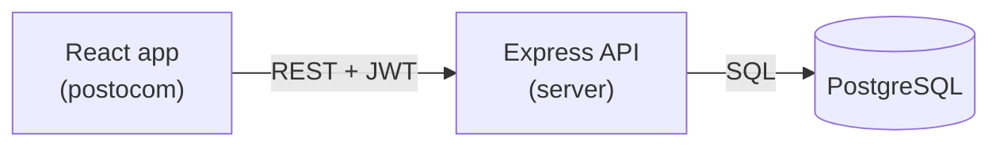

```
poscon/
├── postocom/              # React frontend
│   └── src/
│       ├── api/client.js  # Shared axios client (base URL, auth header, session expiry)
│       ├── context/       # Auth and cart state shared across the app
│       └── component/     # Pages and UI components
├── server/                # Express API
│   ├── server.js          # Entry point
│   ├── src/
│   │   ├── app.js         # Express setup, middleware and routes
│   │   ├── config/        # Environment and database pool
│   │   ├── routes/        # Route definitions
│   │   ├── controllers/   # Request handlers
│   │   ├── middleware/    # Auth, validation, rate limiting, errors
│   │   ├── validation/    # zod request schemas
│   │   ├── docs/          # OpenAPI spec served at /docs
│   │   └── utils/
│   ├── tests/             # Jest + Supertest API tests
│   └── db/
│       ├── migrations/    # SQL schema, applied in order
│       ├── migrate.js     # Migration runner
│       ├── seed.js        # Sample products and demo user
│       └── products.js    # Seed product data
├── e2e/                   # Playwright end-to-end tests
├── .github/workflows/     # CI pipeline
├── docker-compose.yml     # PostgreSQL, API and frontend in containers
├── docs/                  # Deployment guide
├── render.yaml            # Render configuration for the API
└── demo/                  # Screenshots
```

### Database

| Table        | Purpose                                                        |
| :----------- | :------------------------------------------------------------- |
| `users`      | Accounts with email, phone number, bcrypt password hash and admin flag |
| `products`   | Catalogue with price, sale price, gender, category, bestseller flag |
| `cart`       | Items in a user's cart, one row per product and size            |
| `orders`     | Placed orders with status, total and shipping address           |
| `order_items`| Products in each order, with the name, image and price at purchase time |
| `payments`   | Every payment attempt with its result, amount and transaction ID |
| `contact_messages` | Messages sent through the contact form, with read status   |
| `bestseller` | View over `products` where the bestseller flag is set          |

## Getting Started

### Quick start with Docker

With [Docker](https://docs.docker.com/get-docker/) installed, one command starts PostgreSQL, the API and the frontend:

```bash
git clone https://github.com/thakaresahil/poscon.git
cd poscon
docker compose up --build
```

Open `http://localhost:3000`. On first start the API applies the migrations and loads the sample data, including the demo accounts above. Data is kept in a Docker volume between restarts; `docker compose down -v` removes it.

### Running without Docker

#### Prerequisites

- Node.js 18 or newer
- PostgreSQL 14 or newer, running locally

#### 1. Clone the repository

```bash
git clone https://github.com/thakaresahil/poscon.git
cd poscon
```

#### 2. Set up the API

```bash
cd server
npm install
cp .env.example .env
```

Edit `.env` with your PostgreSQL details and a long random `SESSION_SECRET`, then create the database and load the sample data:

```bash
createdb poscon
npm run db:reset
npm run dev
```

The API runs on `http://localhost:9000`.

#### 3. Set up the frontend

In a new terminal:

```bash
cd postocom
npm install
cp .env.example .env
npm start
```

The app opens at `http://localhost:3000`.

### Environment variables

**server/.env**

| Variable         | Description                                         |
| :--------------- | :-------------------------------------------------- |
| `PG_USER`        | PostgreSQL user                                     |
| `PG_HOST`        | PostgreSQL host                                     |
| `PG_DATABASE`    | Database name                                       |
| `PG_PASSWORD`    | PostgreSQL password                                 |
| `PG_PORT`        | PostgreSQL port                                     |
| `DATABASE_URL`   | Hosted database connection string (e.g. Neon); used instead of the `PG_*` values when set |
| `DATABASE_SSL`   | Set to `false` to connect to a hosted database without SSL (default: SSL with certificate checks) |
| `TRUST_PROXY`    | Number of proxies in front of the API, `1` on Render (default `0`) |
| `ADMIN_EMAIL` / `ADMIN_PASSWORD` | Admin account created by the seed script (default `admin@poscon.dev` / `admin1234`) |
| `PORT`           | Port the API listens on (default `9000`)            |
| `CLIENT_ORIGIN`  | Frontend URL(s) allowed by CORS, comma separated    |
| `SESSION_SECRET` | Secret used to sign JWTs                            |
| `PG_TEST_DATABASE` | Database used by the test suites (default `poscon_test`, must end in `_test`) |
| `AUTH_RATE_LIMIT` | Login and signup attempts allowed per 15 minutes (default `20`) |
| `CONTACT_RATE_LIMIT` | Contact form messages allowed per 15 minutes from one address (default `5`) |

**postocom/.env**

| Variable            | Description                                   |
| :------------------ | :-------------------------------------------- |
| `REACT_APP_API_URL` | URL of the API (default `http://localhost:9000`) |

### Scripts

Run these inside `server/`:

| Command              | Description                                   |
| :------------------- | :-------------------------------------------- |
| `npm start`          | Start the API                                 |
| `npm run dev`        | Start the API and restart on file changes     |
| `npm run db:migrate` | Apply any new migrations                      |
| `npm run db:seed`    | Replace all data with the sample data         |
| `npm run db:setup`   | Apply migrations and seed only if the database is empty (used by Docker) |
| `npm run db:reset`   | Drop everything, migrate and seed             |
| `npm run lint`       | Check the code with ESLint                    |
| `npm test`           | Run the API tests                             |
| `npm run test:coverage` | Run the API tests with a coverage report   |

## Deployment

The app is set up to run on free tiers of [Neon](https://neon.tech) (PostgreSQL), [Render](https://render.com) (API, configured by [`render.yaml`](render.yaml)) and [Vercel](https://vercel.com) (frontend, configured by [`postocom/vercel.json`](postocom/vercel.json)). The API checks itself at `/health`, applies new migrations on start-up and seeds an empty database. Follow the step-by-step [deployment guide](docs/DEPLOYMENT.md).

## Testing

| Suite | Tool | What it covers | Command |
| :---- | :--- | :------------- | :------ |
| API | Jest + Supertest | 116 tests: auth, profile, products and search, cart and sizes, orders, payments, contact messages, admin access, API docs accuracy, plus unit tests for the payment helpers | `cd server && npm test` |
| Frontend | Jest + React Testing Library | Card helpers, formatting and the product card component | `cd postocom && npm test` |
| End to end | Playwright | 13 journeys in a real browser: sign up, search, sizes, cart, checkout, declined and successful payment, order history, saved address, contact form, admin adding a product, shipping an order and reading messages, protected pages, and phone layouts | `cd e2e && npm test` |

The API suite reaches **about 96% line coverage** (`npm run test:coverage`).

The API and end-to-end tests run against a separate PostgreSQL database (`poscon_test` by default), which is created and rebuilt from the migrations and seed data before each run, so they never touch development data. The test setup refuses to run against a database whose name does not end in `_test`.

### Continuous integration

Every push runs the [CI workflow](.github/workflows/ci.yml) on GitHub Actions:

| Job | Steps |
| :-- | :---- |
| API | ESLint, then the API tests with coverage against a PostgreSQL 16 service |
| Frontend | ESLint, unit tests, and a production build that fails on any warning |
| End to end | Playwright tests against the real API, frontend and database (runs after the first two pass) |
| Docker | Builds both images, starts the stack with Docker Compose and checks the API and frontend respond |

Failed end-to-end runs upload the Playwright report with screenshots and traces.

To run the end-to-end tests for the first time:

```bash
cd e2e
npm install
npx playwright install chromium
npm test
```

Playwright starts the API on port 9100 and the frontend on port 3100 by itself, so it can run alongside a local dev setup.

## API Reference

**Interactive docs:** with the API running, open [`http://localhost:9000/docs`](http://localhost:9000/docs) for Swagger UI. Every endpoint can be tried from the browser: run `POST /login` with a demo account, click **Authorize** and paste the token to call protected and admin endpoints. The raw OpenAPI 3 spec is at `/docs/openapi.json`.

A test checks that the spec lists exactly the routes the server has and that real responses match the documented fields, so the docs cannot drift out of date.

Endpoints marked 🔒 need an `Authorization: Bearer <token>` header, which the frontend sends automatically after login.

| Method  | Endpoint                      | Description                              |
| :------ | :---------------------------- | :--------------------------------------- |
| `POST`  | `/signup/user`                | Create an account (`email`, `pnum`, `password`) |
| `POST`  | `/login`                      | Log in and receive a token (`email`, `password`) |
| `GET`   | `/data`                       | Latest products for the home page        |
| `GET`   | `/home/bestseller`            | Bestselling products                     |
| `GET`   | `/products`                   | Search and filter products (see below)   |
| `GET`   | `/products/categories`        | Product categories with product counts   |
| `GET`   | `/health`                     | Checks the API and database are up       |
| `GET`   | `/products/:id`               | A single product                         |
| `GET`   | `/profile` 🔒                 | Logged-in user's profile                 |
| `PATCH` | `/profile` 🔒                 | Update name, phone and saved address     |
| `PATCH` | `/profile/password` 🔒        | Change the password (`currentPassword`, `newPassword`) |
| `POST`  | `/contact`                    | Send a message to the store (`name`, `email`, `subject`, `message`) |
| `GET`   | `/cartdata` 🔒                | Items in the user's cart                 |
| `POST`  | `/addtocart` 🔒               | Add a product to the cart, or increase its quantity (`pid`, `count`, `size`) |
| `PATCH` | `/cart/:id` 🔒                | Change the quantity of a cart item (`quantity`, 1 to 10) |
| `DELETE`| `/cart/:id` 🔒                | Remove an item from the cart             |
| `POST`  | `/orders` 🔒                  | Place an order from the cart (`name`, `phone`, `address`, `city`, `pincode`) |
| `GET`   | `/orders` 🔒                  | The user's orders, newest first           |
| `GET`   | `/orders/:id` 🔒              | A single order with its items, shipping address and payment details |
| `POST`  | `/orders/:id/pay` 🔒          | Pay for an order with `card`, `upi` or `cod` (simulated) |

### Product search

`GET /products` accepts these query parameters, all optional:

| Parameter  | Description                                                          |
| :--------- | :------------------------------------------------------------------- |
| `q`        | Text to search for in the product name, description and category     |
| `gender`   | `men` or `women`                                                      |
| `category` | A category from `/products/categories`, e.g. `accessories`           |
| `minPrice` | Lowest sale price in rupees                                          |
| `maxPrice` | Highest sale price in rupees                                         |
| `sort`     | `newest` (default), `popular`, `price_asc`, `price_desc` or `discount` |
| `page`     | Page number, starting at 1                                           |
| `limit`    | Products per page, 1 to 48 (default 12)                              |

Example: `/products?q=shirt&gender=men&sort=price_asc&page=1`

The response contains `products`, `total`, `page`, `limit` and `totalPages`. Text search uses a trigram index (`pg_trgm`) so it stays fast as the catalogue grows.

### Admin endpoints

All admin endpoints need a token for a user with the admin role. Other users get `403`.

| Method   | Endpoint                | Description                                        |
| :------- | :---------------------- | :------------------------------------------------- |
| `GET`    | `/admin/stats`          | Totals, daily revenue for 30 days, top products and recent orders |
| `GET`    | `/admin/orders`         | All orders, optionally filtered by `status`, with `page` and `limit` |
| `PATCH`  | `/admin/orders/:id`     | Change an order's `status` (only valid transitions are allowed) |
| `POST`   | `/admin/products`       | Create a product                                   |
| `PUT`    | `/admin/products/:id`   | Update a product                                   |
| `DELETE` | `/admin/products/:id`   | Delete a product (past orders keep their copy)     |
| `GET`    | `/admin/messages`       | Contact form messages, optionally filtered by `status` (`new` or `read`) |
| `PATCH`  | `/admin/messages/:id`   | Mark a message as `read` or `new`                  |

Errors are returned as JSON in the form `{ "error": "message" }` with a matching status code (`400`, `401`, `402`, `403`, `404`, `409`, `429` or `500`).

## Demo Payments

Payments are simulated. No real payment gateway is used and no money is taken. Card numbers are checked with the Luhn algorithm and the expiry date must be in the future.

| Method | Test value            | Result             |
| :----- | :-------------------- | :----------------- |
| Card   | `4242 4242 4242 4242` | Payment succeeds   |
| Card   | `4000 0000 0000 0002` | Card declined      |
| Card   | `4000 0000 0000 9995` | Insufficient funds |
| UPI    | `demo@okaxis`         | Payment succeeds   |
| UPI    | `fail@upi`            | Payment declined   |

Use any name, any future expiry date and any 3 digit CVV. A declined payment leaves the order unpaid so it can be retried from the order page.

## Screenshots

| | |
| :-: | :-: |
| **Browse with filters and sorting** | **Product page** |
| 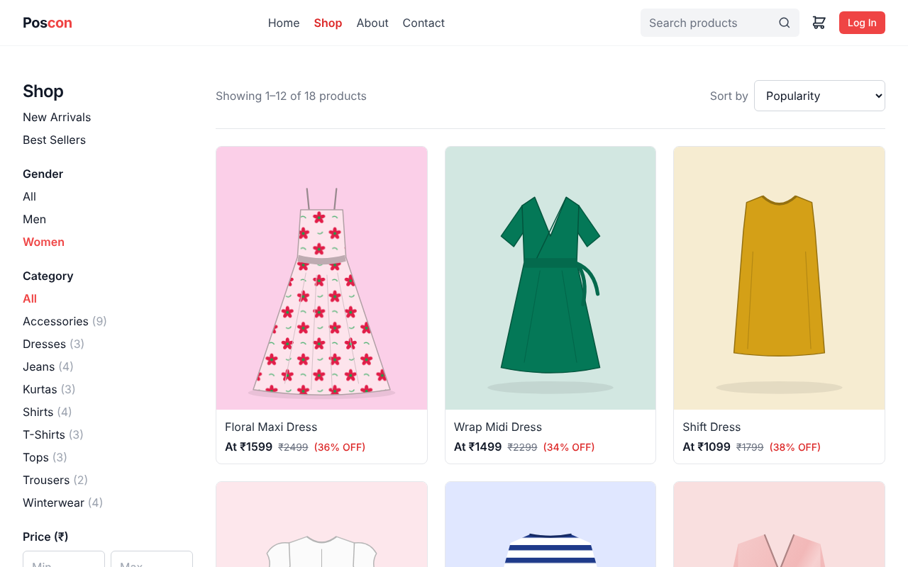 | 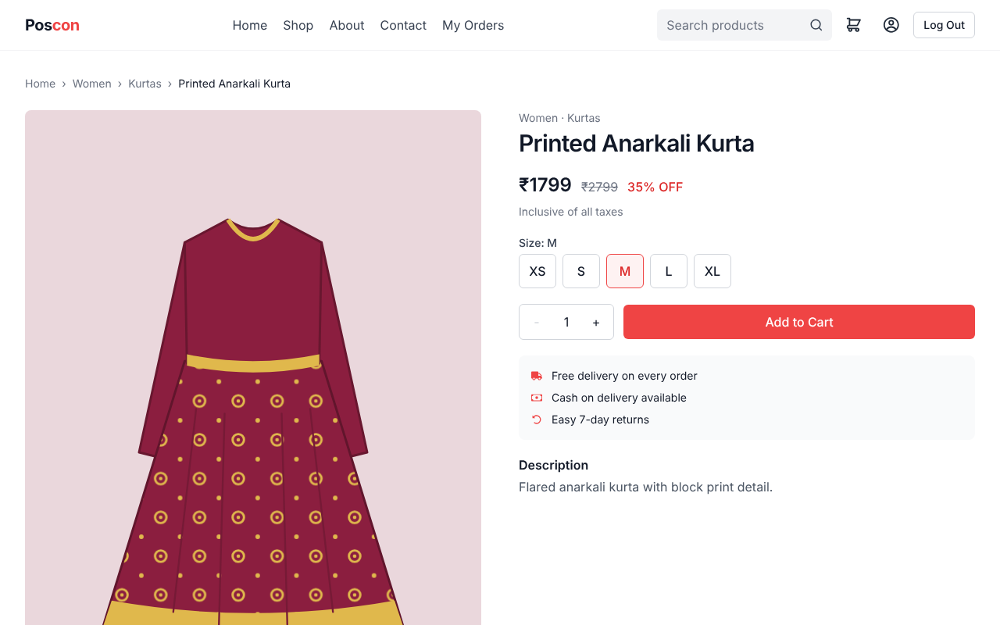 |
| **Cart** | **Checkout** |
| 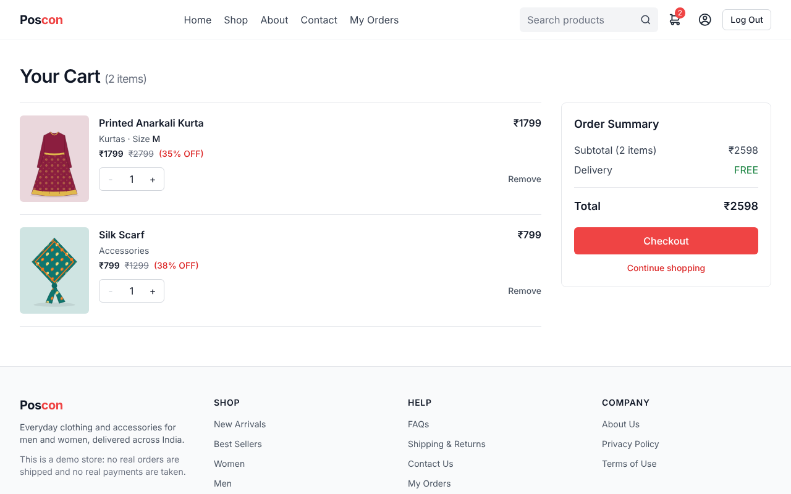 | 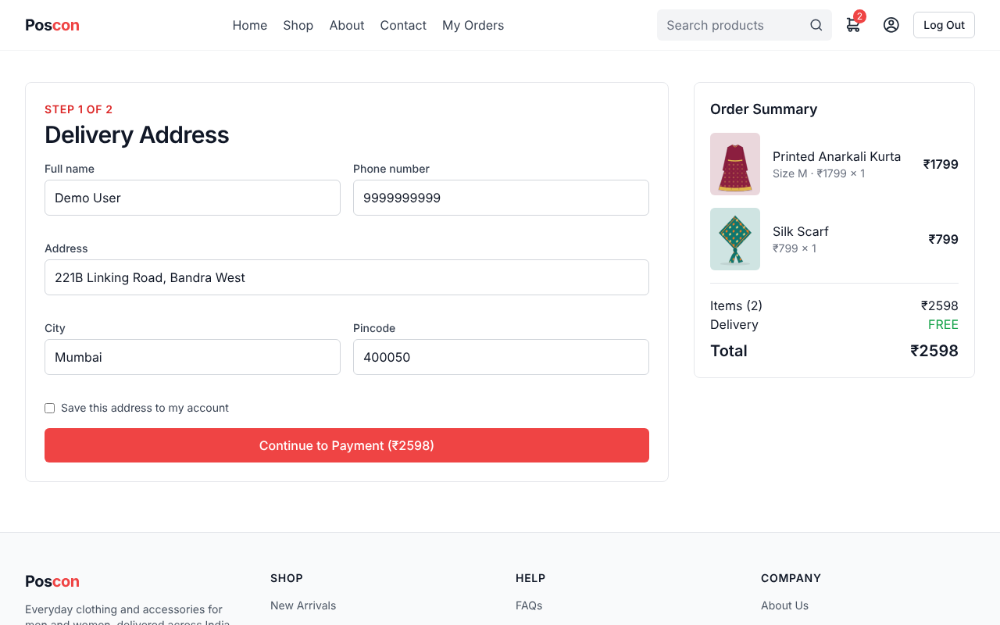 |
| **Simulated payment** | **Order confirmation** |
| 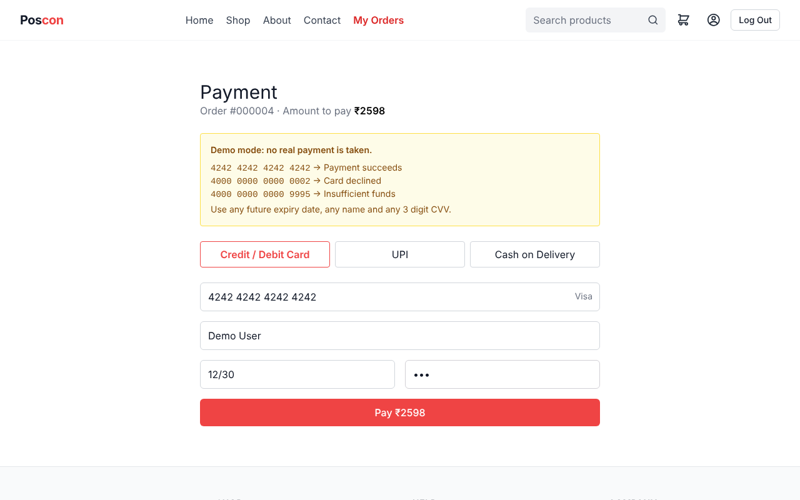 | 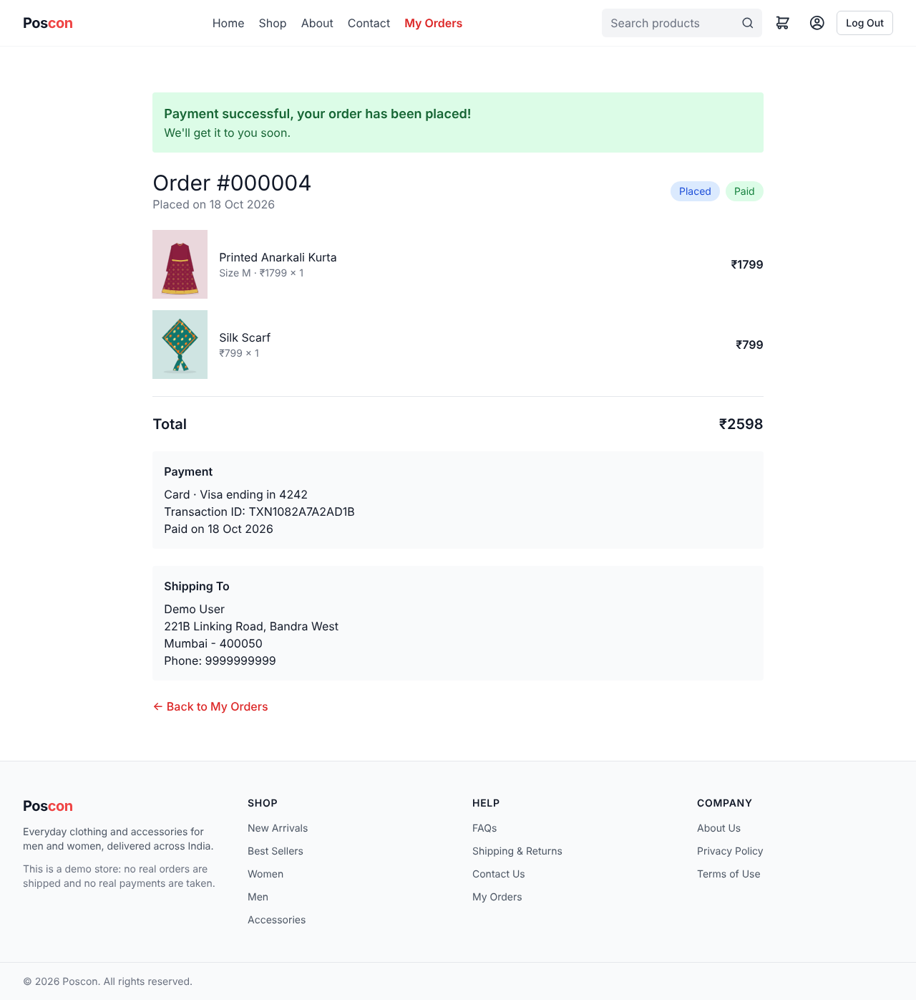 |
| **Admin dashboard** | **Admin orders** |
| 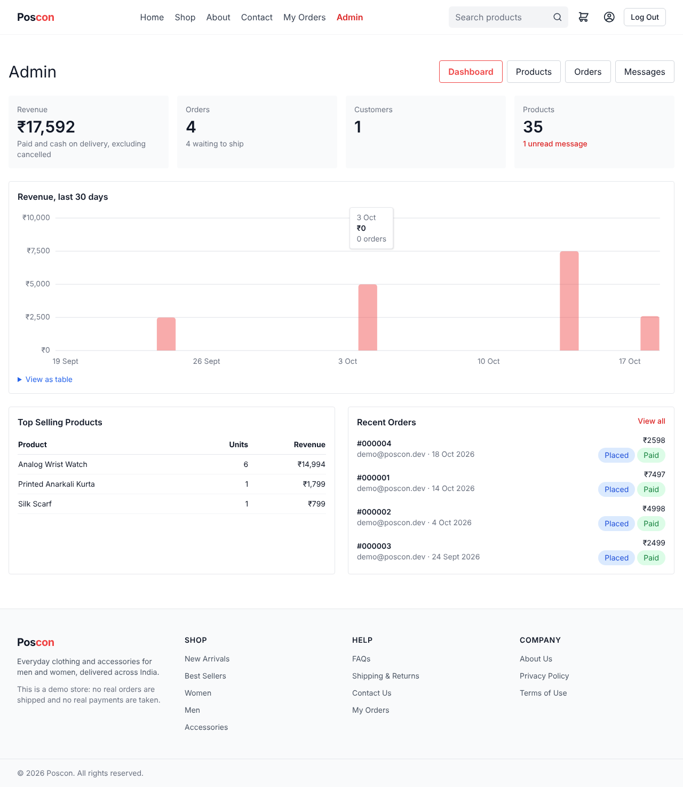 | 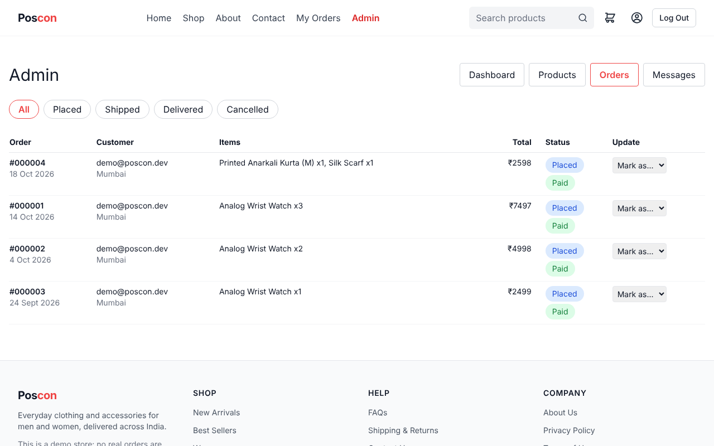 |
| **Account** | **Contact** |
| 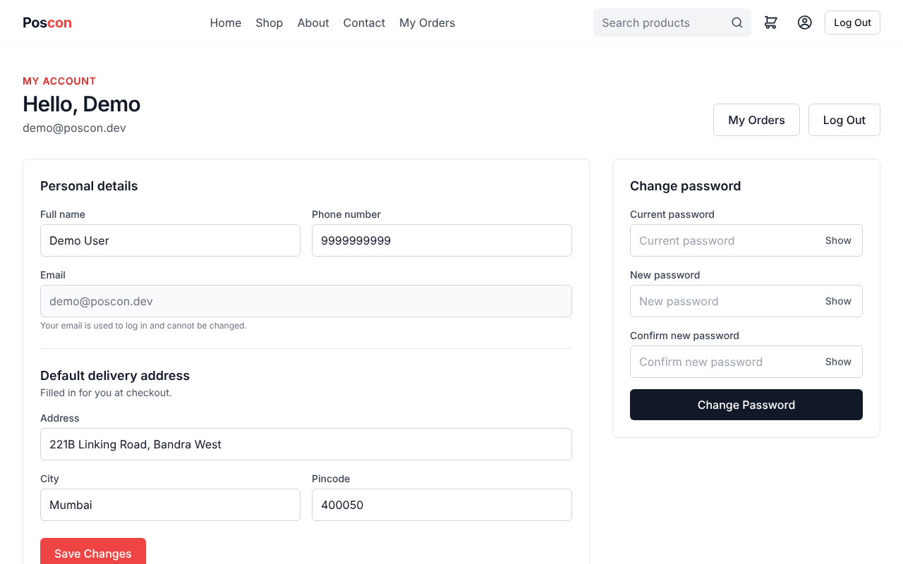 | 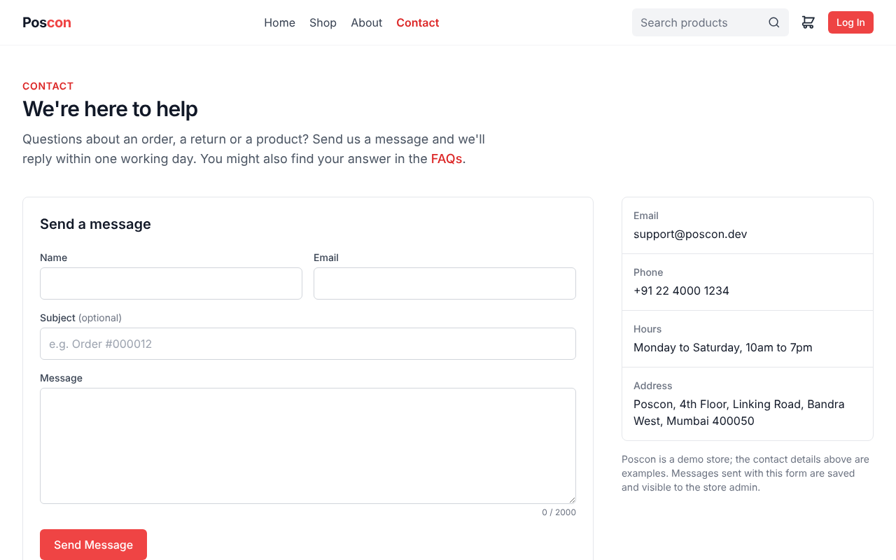 |
| **Admin messages** | **Interactive API docs** |
| 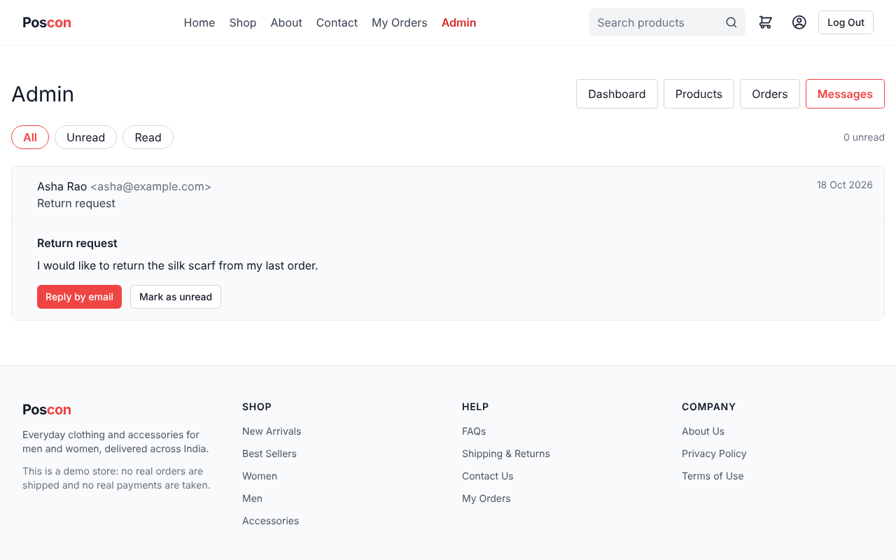 | 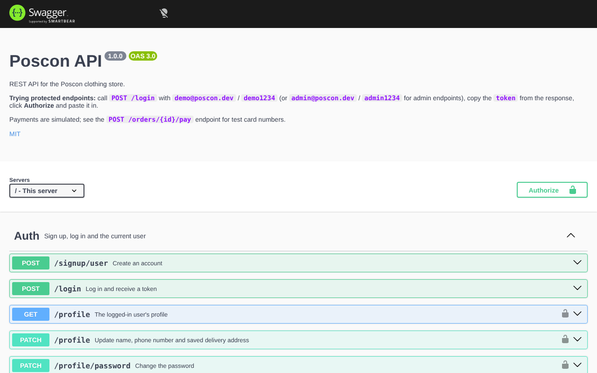 |

<p align="center">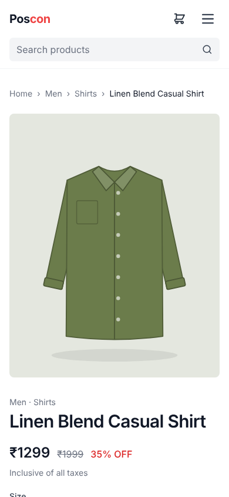</p>

Product images are original illustrations, one per product, created by [`postocom/scripts/generate-product-images.mjs`](postocom/scripts/generate-product-images.mjs). Admins can replace any of them with a photo URL from the product form.

## Roadmap

- [x] Cart quantity updates and item removal
- [x] Orders and order history
- [x] Simulated payment flow
- [x] Search, filters, sorting and pagination
- [x] Admin dashboard
- [x] Automated tests
- [x] CI pipeline
- [x] Docker setup
- [x] API docs (OpenAPI + Swagger UI)
- [x] Live deployment
- [x] Responsive design, content pages, contact form, account settings and product sizes

## License

This project is licensed under the [MIT License](LICENSE).
